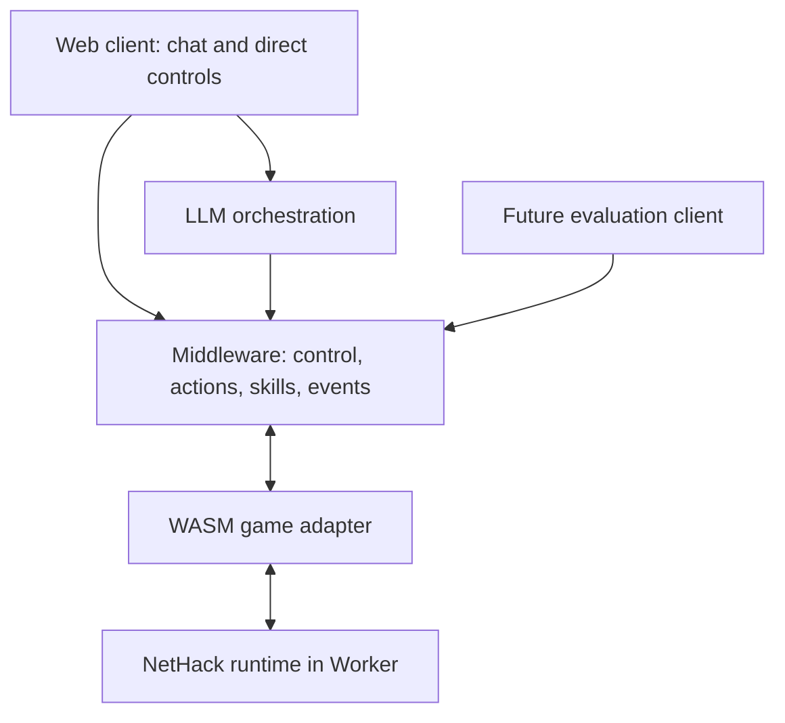

# NetHack-Chat

> **Play NetHack with natural language.**

NetHack-Chat is a **middleware and interaction layer that exposes NetHack as a language-controllable environment** for humans and LLM agents. The human and the AI operate *the same character in the same game session*: language can query, propose, execute, or delegate; direct controls always remain available through the same execution authority.

The core deliverable is the **NetHack-Chat Middleware**: a reusable, model-independent interface for observing the game (`observe()`), executing typed actions (`step()`), running bounded skills (`executeSkill()`), and managing human/AI control ownership (`stop()` / `takeOver()`). **NetHack-Chat Web** is its first client; a future evaluation runner uses the same contracts.

This repository implements the design described in the developer handoff ("Middleware-first architecture", 2026-09-30). All schemas here are **our proposed contracts**, not existing NetHack exports.

---

## 1. Architecture



Key invariants (enforced by code, not documentation):

| Invariant | Where enforced |
|---|---|
| **One write path** into the runtime; all inputs serialize through one scheduler | `packages/core/src/scheduler.ts` |
| **Observations are player-visible only**; visible vs. remembered tiles distinguished; uncertainty preserved (`null` = unknown) | `packages/adapter-wasm/src/fake-runtime.ts`, `packages/core/src/session.ts` |
| **`observe()` never advances game time** | contract + `eval/harness.mts` acceptance case |
| **Control epochs**: late proposals/actions from an older epoch never execute | `packages/core/src/control.ts` |
| **Stale/duplicate/unsupported requests cause zero runtime input**; duplicate request IDs return the prior result | `packages/core/src/session.ts` |
| **Skills issue one step at a time**, recheck state after each action, honor budgets and stop rules | `packages/skills/src/walk-to.ts` |
| **Malformed model output => explanation, no runtime input** | `packages/agent/src/orchestrate.ts` |

## 2. Repository Layout

```
packages/core/          Contracts, scheduler, validation, control manager, event schema
packages/adapter-wasm/  GameAdapter interface, input-state machine, observation mapping
                        (real NH5.0 WASM shim bridge is the runtime-spike task - see docs/runtime-spike.md)
packages/skills/        walk_to (bounded navigation); explore_room stub with explicit gaps
packages/agent/         Structured AgentDecision contract, provider abstraction, offline echo provider
apps/web/               Non-UI demo host wiring the full stack together
apps/model-gateway/     Optional provider proxy skeleton (credentials stay server-side)
eval/                   Scripted non-visual harness + MVP acceptance checklist runner
vendor/                 Pinned upstream revisions, build commands, license notices (to fill during spike)
docs/                   Handoff spec, runtime spike notes, contracts, ADRs
```

Workspace packages use the `@nhchat/*` scope. `apps/web` imports only `@nhchat/*` public entry points - it never touches the runtime directly, satisfying the "client independence" acceptance criterion.

## 3. Public Middleware API (`@nhchat/core`)

```ts
interface NetHackSession {
  observe(): Promise<Observation>;                    // stable snapshot, no game time consumed
  step(request: ActionRequest): Promise<StepResult>;  // validated, serialized single action
  executeSkill(request: SkillRequest): Promise<TaskHandle>; // bounded delegated task
  stop(reason?: string): Promise<StopResult>;         // revoke AI execution, cancel tasks
  takeOver(): Promise<StopResult>;                    // stop + return ownership to human
  subscribe(listener: (event: SessionEvent) => void): () => void;
}
```

Typed actions (the model may only propose these):

```ts
type GameAction =
  | { action: "move"; direction: Direction }
  | { action: "wait" }
  | { action: "open"; direction: Direction }
  | { action: "pickup" }
  | { action: "respond"; promptId: string; response: PromptResponse };
```

Step statuses: `completed | rejected | needs_input | cancelled | game_over`. Requests carry `expected_state_version` and `control_epoch`; anything stale is rejected **before** touching the runtime.

Interaction modes (separate from execution ownership - only one controller writes at a time): `human`, `suggest`, `approval`, `delegated`, `agent` (reserved).

## 4. Quick Start

```bash
npm install                # Node >= 20, npm >= 10

npm run typecheck          # compile every package + app
npm run eval               # scripted-client acceptance suite against the fake runtime
npm run demo               # full vertical slice: "Walk to that door" -> walk_to -> steps -> takeover
```

Expected demo ending (deterministic):

```
task finished: completed
owner: human (epoch 3)
turn delta over whole run: 8 game turns
```

**Important:** until the runtime spike lands (see below), the local demo runs against a
small deterministic **fake NetHack-like runtime** inside the adapter package so the
contracts can be exercised end-to-end. It is clearly labeled and must not be presented
as a real game session in any delivered demo (MVP acceptance requires a real WASM session).

## 5. Implementation Status

| Area | Status | Notes |
|---|---|---|
| Observation / action / request / event schemas | Implemented | `packages/core/src/types.ts`, runtime validation in `validate.ts` |
| Single-writer scheduler | Implemented | `packages/core/src/scheduler.ts` |
| Control manager (modes, epochs, lease policy) | Implemented | `packages/core/src/control.ts` |
| Session core (dedup, staleness, needs_input, Stop/Take over) | Implemented | `packages/core/src/session.ts` |
| Event log (ordered, replayable trace JSONL) | Implemented | `packages/core/src/events.ts` |
| WASM adapter boundary + input-state machine | Interface implemented | `GameAdapter` in `packages/adapter-wasm/src/adapter.ts` |
| Fake runtime for contract testing | Implemented | `fake-runtime.ts` - dev/test only |
| Real NetHack 5.0 WASM shim bridge | TODO (milestone 1) | Requires pinning upstream + browser build; plan in `docs/runtime-spike.md` |
| `walk_to` skill (budgets + stop rules via `step()`) | Implemented | `packages/skills/src/walk-to.ts` |
| `explore_room` skill | Stub | Explicit gaps documented in source; add after interruption contract proven on real runtime |
| Agent decision contract + provider abstraction | Implemented | `packages/agent/`; OpenAI-compatible gateway skeleton ready |
| Offline intent parsing (demo QA/move/open/pickup/walk) | Implemented (narrow) | `offline-provider.ts`; real interpretation delegated to an LLM |
| Web client UI (map/chat panels) | TODO | `apps/web` currently hosts the wired session only |
| Evaluation runner | Started | `eval/harness.mts` + `eval/acceptance.mts` |

## 6. Roadmap (agreed implementation order)

1. **Runtime spike** - pin/build `e3sh/Nethack-wasm-webUI` (NetHack 5.0 shim), map callbacks, verify input boundaries/menus/termination, inventory accessible observations, record licenses. *(Not done in this repo yet - see `docs/runtime-spike.md`.)*
2. **Contracts and adapter** - done here (schemas, four primitive actions, scripted client).
3. **Execution core** - done here (queue, dedup, epochs, events, Stop/Take over; verified before connecting a model).
4. **First skill** - `walk_to` done; `explore_room` gated on milestone 7 validation.
5. **Agent integration** - contract + offline provider done; connect one real provider via `apps/model-gateway`.
6. **Web integration** - attach renderer + chat to the same session.
7. **MVP validation** - run the acceptance cases (`eval/acceptance.mts`) against **real** game sessions; inspect traces.
8. **Extensions** - `explore_room`, more item commands, evaluation adapter, more providers.

First working milestone (definition of done): *a client observes a real NetHack session, executes a typed action, runs one bounded navigation skill, and reclaims control without stale AI inputs continuing afterward.*

## 7. Grounding & Upstream References

Checked 2026-09-30; they establish an integration direction, not proof that any field/API below exists upstream. See `docs/runtime-spike.md` for the verification checklist and `vendor/UPSTREAM.md` for pinned revisions/notices.

- [Official NetHack source](https://github.com/NetHack/NetHack) - engine + window-port code (NetHack 5.0.0)
- [NetHack WASM WebUI](https://github.com/e3sh/Nethack-wasm-webUI) - initial integration candidate
- [Cross-compiling doc](https://github.com/NetHack/NetHack/blob/NetHack-5.0/Cross-compiling) - runtime spike reference
- [NLE](https://github.com/facebookresearch/nle) - later experimental adapter only; no semantic parity assumed

Licenses: NetHack ships under the NetHack Community License; tilesets/assets have their own notices. Record actual files at pinned revisions before packaging decisions.

## 8. Design Rules You Must Not Break

Condensed from the handoff (sections 5-10); violations are bugs, not style choices:

1. Expose only player-visible information; keep observed != known (`null`/unknown markers).
2. Coordinates: origin upper-left, x increases east, y increases south, meaningful only with a `level_id`. Distinguish visible vs remembered tiles.
3. Never blindly inject precomputed key strings; encode only the expected action-specific prompt sequence and stop at unexpected prompts.
4. Core-generated metadata (source, control epoch) comes from orchestration/control, never from model output.
5. Invalid/stale/duplicate requests leave the runtime untouched; uncertain commits get reconciliation, not re-execution.
6. Stop revokes AI permission immediately, increments the epoch, discards uncommitted inputs; already-committed engine work settles to the next input boundary (no undo promises).
7. Skills go through `step()` only - no direct runtime writes; user constraints can tighten, the model cannot relax them; read-only questions never grant a control lease.
8. Logging includes turn/state version/epoch/request IDs; exclude credentials and hidden reasoning.

## 9. License

Project code: MIT (see `LICENSE`). Reused upstream components retain their original licenses and notices - preserve them; final packaging follows the files at pinned revisions.
