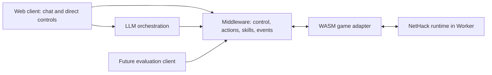

# dsh-nethack

[](https://www.npmjs.com/package/@yeaszn/dsh-neth4ck) [](LICENSE) [](https://github.com/topics/dsh-plugin)

Maintained by [@yeasen-z](https://github.com/yeasen-z)


**Play NetHack in natural language, inside [DeepSeek Harness](https://github.com/deepseek-ai/deepseek-harness) (DSH).**

The game runs the real NetHack 3.6.7 engine (WASM). You and an AI partner drive the
same character in the same game session — play it yourself with the on-screen pad,
or hand the character to the model and talk to it in an ordinary DSH conversation.


**Requirements:** DSH `>=0.2.1-rc.3 <0.3.0` (`engines.dsh`; only 0.2.1-rc.3 has been
exercised). A configured model is needed only for the AI partner; the manual
controls work without one.

## 1. Quick install from npm

Package: **`@yeaszn/dsh-neth4ck`** (the current release is `0.2.2`).

In DSH, open **Plugins → Add plugin** and enter:

```text
@yeaszn/dsh-neth4ck@0.2.2
```

Approve the install, enable **both** the NetHack plugin and its `nethack` preset,
refresh DSH, then open the **@ / NetHack** panel.

- The package is published as `dsh-neth4ck` because npm refuses new names that
  contain `nethack`. Inside DSH it is still called NetHack.
- If you get `404 Not Found`, your install source mirror has not synced the package
  yet (for example `registry.npmmirror.com`). Switch to **npm official**, or wait a
  few minutes and retry.
- Only one copy of this plugin can be installed at a time. To change versions,
  uninstall first.

The plugin market also lists it: **Plugins → Discover → Add index source**, paste
`https://raw.githubusercontent.com/yeasen-z/dsh-nethack/main/plugins/dsh-nethack/market/index.json`,
then search for either `nethack` or the exact package name `@yeaszn/dsh-neth4ck`
(search covers the entry's `name`, so the full package name matches directly).

Both entries route through DSH's own npm handling: **Add plugin** with a package
name and the market's install button fetch the same published tarball, so pick
whichever you reach first.

## 2. Local development from git clone

```sh
git clone https://github.com/yeasen-z/dsh-nethack.git
cd dsh-nethack
```

Then, in a DSH session, ask:

> Install the local bundle at `/absolute/path/to/dsh-nethack/plugins/dsh-nethack` using the plugin manager. Enable both the NetHack plugin and its nethack agent preset.

To update after you change code, pull (`git pull --ff-only`) or edit, then ask DSH
to reinstall the same local bundle and restart DSH.

Do not symlink the bundle into your DSH profile by hand, and do not install the whole
repository as an npm package. The installable unit is `plugins/dsh-nethack`. Run the
tests with `node plugins/dsh-nethack/tests/<name>.mjs`.

To pin a released commit instead of a clone, use the git source in
`market/index.json` (`versions[0].source.commit`). Pin a full SHA, because a branch
would change under you.

## 3. What it is for

**Play it yourself.** Use the direction pad, verbs and free-key field in the
console, the pack tab for inventory, and the message log. No model is required.

**Let an agent play it.** The game is an environment an LLM agent can observe and
act in, with the same controls and the same character as the human:

- observe the map, status and inventory;
- propose typed actions, or run a bounded skill such as walking to a target;
- hand control back and forth. Stop revokes the agent's permission immediately, so
  late actions from an earlier turn never run.

The human and the agent share one game. This makes the project useful both as a
companion to play with and as a gaming environment for studying agent behaviour.
The contracts are described in the developer reference below.

## Limits

- One live game per Host process. Quitting DSH ends the in-memory game; chat history
  is not a saved NetHack game.
- Model calls use your configured provider and may incur charges.

---

## Middleware library (developer reference)

The plugin is built on a middleware library that exposes NetHack as an
environment that humans and LLM agents can control. You do not need this section
to play; it describes the contracts, invariants and test harness under
`packages/`, `apps/` and `eval/`.

## 1. Architecture



Key invariants (enforced by code, not documentation):

| Invariant | Where enforced |
|---|---|
| **One write path** into the runtime; all inputs serialize through one scheduler | `packages/core/src/scheduler.ts` |
| **Observations are player-visible only**; visible vs. remembered tiles distinguished; uncertainty preserved (`null` = unknown) | `packages/adapter-wasm/src/fake-runtime.ts`, `packages/core/src/session.ts` |
| **`observe()` never advances game time** | contract + `eval/harness.mts` acceptance case |
| **Control epochs**: late proposals/actions from an older epoch never execute | `packages/core/src/control.ts` |
| **Stale/duplicate/unsupported requests cause zero runtime input**; duplicate request IDs return the prior result | `packages/core/src/session.ts` |
| **Skills issue one step at a time**, recheck state after each action, honor budgets and stop rules | `packages/skills/src/walk-to.ts` |
| **Malformed model output => explanation, no runtime input** | `packages/agent/src/orchestrate.ts` |

## 2. Repository Layout

```
packages/core/          Contracts, scheduler, validation, control manager, event schema
packages/adapter-wasm/  GameAdapter interface, input-state machine, observation mapping
                        (pinned NetHack shim bridge and initial real adapter)
packages/skills/        walk_to (bounded navigation); explore_room stub with explicit gaps
packages/agent/         Structured AgentDecision contract, provider abstraction, offline echo provider
apps/web/               Non-UI demo host wiring the full stack together
apps/model-gateway/     Optional provider proxy skeleton (credentials stay server-side)
eval/                   Scripted non-visual harness + MVP acceptance checklist runner
vendor/                 Pinned upstream revisions and license notes
docs/                   Architecture, real runtime build, contracts, implementation plan
```

Workspace packages use the `@nhchat/*` scope. `apps/web` imports only `@nhchat/*` public entry points - it never touches the runtime directly, satisfying the "client independence" acceptance criterion.

## 3. Public Middleware API (`@nhchat/core`)

```ts
interface NetHackSession {
  observe(): Promise<Observation>;                    // stable snapshot, no game time consumed
  step(request: ActionRequest): Promise<StepResult>;  // validated, serialized single action
  executeSkill(request: SkillRequest): Promise<TaskHandle>; // bounded delegated task
  stop(reason?: string): Promise<StopResult>;         // revoke AI execution, cancel tasks
  takeOver(): Promise<StopResult>;                    // stop + return ownership to human
  subscribe(listener: (event: SessionEvent) => void): () => void;
}
```

Typed actions (the model may only propose these):

```ts
type GameAction =
  | { action: "move"; direction: Direction }
  | { action: "wait" }
  | { action: "open"; direction: Direction }
  | { action: "pickup" }
  | { action: "respond"; promptId: string; response: PromptResponse };
```

Step statuses: `completed | rejected | needs_input | cancelled | game_over`. Requests carry `expected_state_version` and `control_epoch`; anything stale is rejected **before** touching the runtime.

Interaction modes (separate from execution ownership - only one controller writes at a time): `human`, `suggest`, `approval`, `delegated`, `agent` (reserved).

## 4. Quick Start

```bash
nvm use                    # Node 20.19.5 (see .nvmrc)
npm ci                     # npm 10.8.2; install exactly from package-lock.json

npm run typecheck          # compile every package + app
npm run doctor             # read-only local environment diagnostics
npm run eval               # scripted-client acceptance suite against the fake runtime
npm run demo               # full vertical slice: "Walk to that door" -> walk_to -> steps -> takeover
npm test                   # real adapter transport/contracts + fetch regression tests
```

`npm ci` is a clean install and replaces the repository's existing
`node_modules`; use it for a fresh clone or when you explicitly intend to
recreate local dependencies. `npm run doctor` is read-only and is safe to run
before changing the current Node/npm setup.

To fetch and compile the pinned original NetHack 5.0 source as WASM:

```bash
npm run bootstrap          # requires Docker/OrbStack, or set up local emsdk first
```

The build artifacts go to the ignored `apps/web/public/runtime/` directory.
Use `NETHACK_BUILD_MODE=local` with an activated Emscripten 4.0.23 SDK to build
without Docker; details and proxy setup are in [docs/runtime-build.md](docs/runtime-build.md).

Expected key results (deterministic fake runtime):

```
[PASS] delegation reached the door-adjacent tile
task outcome after takeover: interrupted ("cancelled_by_stop")
owner: human (epoch 4)
human pickup -> completed: You pick up a potion (unidentified).
```

The local `demo` and default `eval` still use the deterministic fake runtime.
The real Worker is now connected to `MiddlewareSession` through a first
`RealWasmAdapter`. After building the runtime:

```bash
npm run runtime:serve       # middleware diagnostic, loopback port 4173
npm run eval:real-node      # real WASM + middleware in a Node Worker; no browser package required
npm run eval:real           # actual Chromium + Worker + WASM, separate from fake tests
```

The browser test uses `CHROMIUM_EXECUTABLE_PATH`, a common system Chrome path,
or Playwright's installed Chromium. `eval:real-node` covers the real engine and
middleware without controlling a desktop browser; it complements but does not
replace cross-browser verification. If needed, install the pinned Playwright
browser with `npx playwright install chromium`.
The diagnostic supports typed movement in all eight directions, waiting,
opening, pickup, prompt responses and takeover. The adapter now reads the
player's inventory from the pinned read-only inventory menu and marks it stale
when the engine reports a change; current visibility/entities and save/load
remain incomplete, so real navigation skills are explicitly disabled. See
[the real adapter notes](docs/real-adapter.md) for the verified scope.

The real-game page now includes an assistant panel. Its default **offline
rules** mode is not an LLM: it handles a small set of status questions and
simple Chinese/English commands. To use a real model, keep `runtime:serve`
running, start `npm run gateway` in another terminal, and configure the gateway
server (never the browser) with `GATEWAY_MODE=openai-compatible`,
`LLM_UPSTREAM_URL`, `LLM_API_KEY`, and `LLM_MODEL`. The gateway's default echo
mode is only a connection check, not an LLM. In either mode, proposed game
actions require an explicit confirmation click before they reach middleware.

## 5. Implementation Status

| Area | Status | Notes |
|---|---|---|
| Observation / action / request / event schemas | Implemented | `packages/core/src/types.ts`, runtime validation in `validate.ts` |
| Single-writer scheduler | Implemented | `packages/core/src/scheduler.ts` |
| Control manager (modes, epochs, lease policy) | Implemented | `packages/core/src/control.ts` |
| Session core (dedup, staleness, needs_input, Stop/Take over) | Implemented | `packages/core/src/session.ts` |
| Event log (ordered, replayable trace JSONL) | Implemented | `packages/core/src/events.ts` |
| WASM adapter boundary + input-state machine | Implemented for the initial real slice | `GameAdapter` in `packages/core/src/types.ts`; `packages/adapter-wasm/src/real-runtime.ts` |
| Fake runtime for contract testing | Implemented | `fake-runtime.ts` - dev/test only |
| Pinned NetHack 5.0 WASM build | Implemented | `npm run bootstrap`; source and toolchain pins in `vendor/upstream-lock.json` |
| Real NetHack Worker bridge and adapter | Initial integration | Typed actions, stable status/terrain, and freshness-marked inventory snapshots; current entities/visibility remain TODO |
| `walk_to` skill (budgets + stop rules via `step()`) | Implemented | `packages/skills/src/walk-to.ts` |
| `explore_room` skill | Stub | Explicit gaps documented in source; add after interruption contract proven on real runtime |
| Agent decision contract + provider abstraction | Implemented | `packages/agent/`; OpenAI-compatible gateway skeleton ready |
| Offline intent parsing (demo QA/move/open/pickup/walk) | Implemented (narrow) | `offline-provider.ts`; real interpretation delegated to an LLM |
| Web client UI | Playable prototype | Large glyph-rendered game map, manual controls, assistant, inventory and messages; original graphical tileset and authoritative visibility remain TODO |
| Evaluation runner | Started | `eval/harness.mts` + `eval/acceptance.mts` |

## 6. Roadmap (agreed implementation order)

1. **Runtime integration** - pinned official NetHack 5.0 builds and runs in a Worker through the first real adapter; next complete current visibility, entities, inventory refreshes and lifecycle handling.
2. **Contracts and adapter** - done here (schemas, four primitive actions, scripted client).
3. **Execution core** - done here (queue, dedup, epochs, events, Stop/Take over; verified before connecting a model).
4. **First skill** - `walk_to` done; `explore_room` gated on milestone 7 validation.
5. **Agent integration** - contract + offline provider done; connect one real provider via `apps/model-gateway`.
6. **Web integration** - attach renderer + chat to the same session.
7. **MVP validation** - run the acceptance cases (`eval/acceptance.mts`) against **real** game sessions; inspect traces.
8. **Extensions** - `explore_room`, more item commands, evaluation adapter, more providers.

First working milestone (definition of done): *a client observes a real NetHack session, executes a typed action, runs one bounded navigation skill, and reclaims control without stale AI inputs continuing afterward.*

## 7. Grounding & Upstream References

Checked 2026-10-02; they establish an integration direction, not proof that any field/API below exists upstream. See `docs/runtime-build.md`, the implementation plan, and `vendor/UPSTREAM.md` for build steps and pinned notices.

- [Official NetHack source](https://github.com/NetHack/NetHack) - engine + window-port code (NetHack 5.0.0)
- [NetHack WASM WebUI](https://github.com/e3sh/Nethack-wasm-webUI) - initial integration candidate
- [Cross-compiling doc](https://github.com/NetHack/NetHack/blob/NetHack-5.0/Cross-compiling) - runtime spike reference
- [NLE](https://github.com/facebookresearch/nle) - later experimental adapter only; no semantic parity assumed

Licenses: the pinned NetHack source includes its General Public License in the embedded `license` file. Third-party reference UI material has a separate license note in `vendor/UPSTREAM.md` and is not included in the game build.

## 8. Design Rules You Must Not Break

Condensed from the handoff (sections 5-10); violations are bugs, not style choices:

1. Expose only player-visible information; keep observed != known (`null`/unknown markers).
2. Coordinates: origin upper-left, x increases east, y increases south, meaningful only with a `level_id`. Distinguish visible vs remembered tiles.
3. Never blindly inject precomputed key strings; encode only the expected action-specific prompt sequence and stop at unexpected prompts.
4. Core-generated metadata (source, control epoch) comes from orchestration/control, never from model output.
5. Invalid/stale/duplicate requests leave the runtime untouched; uncertain commits get reconciliation, not re-execution.
6. Stop revokes AI permission immediately, increments the epoch, discards uncommitted inputs; already-committed engine work settles to the next input boundary (no undo promises).
7. Skills go through `step()` only - no direct runtime writes; user constraints can tighten, the model cannot relax them; read-only questions never grant a control lease.
8. Logging includes turn/state version/epoch/request IDs; exclude credentials and hidden reasoning.

## 9. License

Project code: MIT (see `LICENSE`). Reused upstream components retain their original licenses and notices - preserve them; final packaging follows the files at pinned revisions.
